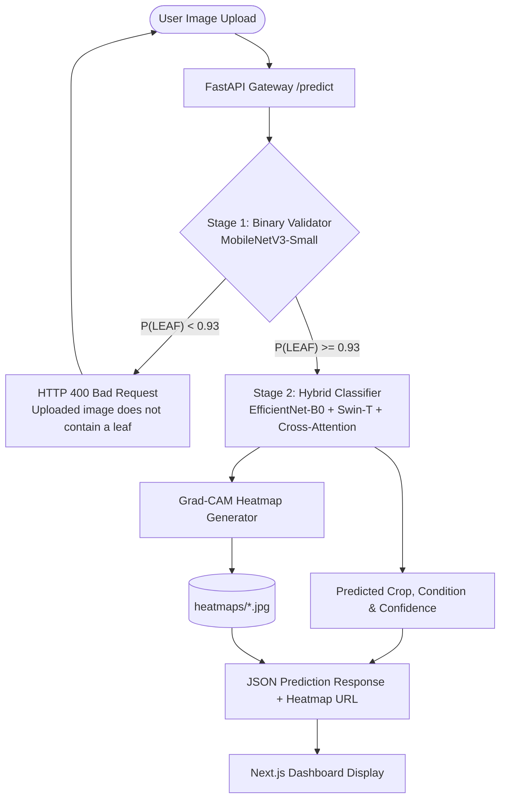

# AgriVisionX: Dual-Stage Multi-Crop Leaf Disease Diagnosis & Explainability System

[](https://www.python.org/)
[](https://pytorch.org/)
[](https://fastapi.tiangolo.com/)
[](https://nextjs.org/)
[](#license--dataset-attribution)

An end-to-end, dual-stage computer vision system designed for robust crop leaf disease detection. AgriVisionX pairs a **MobileNetV3-Small binary input validator** with a **Hybrid CNN–Swin Transformer 29-class disease classifier** and **Grad-CAM visual explainability**, ensuring out-of-domain non-leaf images are rejected before high-capacity diagnostic inference.

---

## Table of Contents

- [Problem Statement](#problem-statement)
- [Key Features](#key-features)
- [System Architecture](#system-architecture)
- [Technical Architecture](#technical-architecture)
  - [Stage 1: Binary Leaf Validator (MobileNetV3-Small)](#stage-1-binary-leaf-validator-mobilenetv3-small)
  - [Stage 2: Hybrid CNN–Transformer Classifier (29 Classes)](#stage-2-hybrid-cnntransformer-classifier-29-classes)
  - [Explainability: Grad-CAM](#explainability-grad-cam)
- [Supported Crops & Disease Classes](#supported-crops--disease-classes)
- [Datasets & Methodology](#datasets--methodology)
- [Evaluation Metrics & Results](#evaluation-metrics--results)
- [Technology Stack](#technology-stack)
- [Repository Structure](#repository-structure)
- [Installation & Setup (macOS / Linux)](#installation--setup-macos--linux)
  - [Prerequisites](#prerequisites)
  - [1. Clone Repository & Setup Git LFS](#1-clone-repository--setup-git-lfs)
  - [2. Backend Setup](#2-backend-setup)
  - [3. Frontend Setup](#3-frontend-setup)
- [API Reference](#api-reference)
- [Known Limitations](#known-limitations)
- [Future Scope](#future-scope)
- [License & Dataset Attribution](#license--dataset-attribution)

---

## Problem Statement

Automated crop disease diagnosis tools deployed in agricultural settings often suffer from false-positive hallucinations when users submit non-leaf imagery (e.g., backgrounds, human faces, soil, tools, or weeds). Standard deep-learning classifiers force an out-of-domain image into one of their predetermined disease classes with high confidence.

AgriVisionX resolves this vulnerability by implementing a **dual-stage decision pipeline**:
1. An upstream lightweight binary gatekeeper validates whether the uploaded image is genuinely a leaf.
2. Only verified leaf images are forwarded to the fused deep-learning classifier and Grad-CAM interpretability engine.

---

## Key Features

- **Dual-Stage Filtering Pipeline**: Rejects arbitrary non-leaf inputs before disease diagnosis.
- **Hybrid Multi-Scale Representation**: Fuses local edge/texture features from EfficientNet-B0 with global contextual dependencies from Swin Transformer Tiny via Cross-Attention.
- **Explainable AI (XAI)**: Generates Grad-CAM heatmaps highlighting exact leaf regions and lesion patterns that guided classification.
- **Comprehensive Crop Coverage**: Supports 29 health and disease classes across 6 economically vital crops (Apple, Corn, Cotton, Potato, Rice, Tomato).
- **Modern Responsive Dashboard**: Next.js frontend with real-time prediction confidence score, risk indicator, and synchronized original vs. heatmap side-by-side comparison.

---

## System Architecture



---

## Technical Architecture

### Stage 1: Binary Leaf Validator (MobileNetV3-Small)
- **Base Architecture**: Lightweight `MobileNetV3-Small` optimized for low-latency inference.
- **Head**: Replaced final projection layer with binary linear head (`nn.Linear(in_features, 2)`).
- **Preprocessing**: `Resize((224, 224))` -> `ToTensor()` -> ImageNet normalization (`mean=[0.485, 0.456, 0.406]`, `std=[0.229, 0.224, 0.225]`).
- **Gating Logic**: Extracts Softmax probability of Class 1 (LEAF). If P(LEAF) < 0.93, the request is immediately rejected with HTTP 400, protecting downstream resources.

### Stage 2: Hybrid CNN–Transformer Classifier (29 Classes)
- **CNN Backbone**: `EfficientNet-B0` (extracts fine-grained localized spatial patterns and spot lesions).
- **Transformer Backbone**: `Swin Transformer Tiny` (captures long-range spatial relationships, venation symmetry, and global leaf context using shifted windows).
- **Fusion Mechanism**: Multi-Head Cross-Attention fuses CNN spatial feature tokens with Swin Transformer representation tokens.
- **Classification Head**: `Linear(512, 256) -> GELU -> Dropout(0.3) -> Linear(256, 29) -> Softmax`.

### Explainability: Grad-CAM
- **Target Layer**: `model.cnn_backbone.backbone.conv_head` (last convolutional layer of EfficientNet-B0).
- **Rendering**: Generates class-activation mapping overlaid onto the RGB leaf image, saved to `heatmaps/<uuid>.jpg` and served statically via `/heatmaps/<filename>`.

---

## Supported Crops & Disease Classes

AgriVisionX classifies 29 conditions across 6 agricultural crops:

| Crop | Disease / Health Conditions Supported |
|---|---|
| **Apple** | Apple Scab, Black Rot, Cedar Apple Rust, Healthy |
| **Corn (Maize)** | Cercospora Leaf Spot / Gray Leaf Spot, Common Rust, Northern Leaf Blight, Healthy |
| **Cotton** | Diseased Leaf, Diseased Plant, Healthy Leaf, Healthy Plant |
| **Potato** | Early Blight, Late Blight, Healthy |
| **Rice** | Bacterial Leaf Blight, Brown Spot, Healthy, Leaf Smut |
| **Tomato** | Bacterial Spot, Early Blight, Late Blight, Leaf Mold, Septoria Leaf Spot, Spider Mites (Two-Spotted Spider Mite), Target Spot, Tomato Yellow Leaf Curl Virus, Tomato Mosaic Virus, Healthy |

---

## Datasets & Methodology

### Binary Validator Dataset
The binary leaf validator was trained on a strictly balanced dataset of 3,000 images (70/15/15 train/val/test split):
- **LEAF (1,500 images)**: 250 images each from Apple, Corn, Cotton, Potato, Rice, and Tomato.
- **NON_LEAF (1,500 images)**: 300 images each from Flowers, Background Without Leaves, Human Faces/People, Animals, and Everyday Objects.
- **Deduplication**: Enforced cross-partition SHA-256 hash checks to prevent data leakage.
- **Augmentation (Training only)**: Random horizontal and vertical flips; evaluation uses deterministic center resize.

---

## Evaluation Metrics & Results

### Leaf Validator Performance (Checkpoint: `model/leaf_validator.pth`)

Evaluated at the selected acceptance threshold of **0.93** on independent validation and test sets (450 images each, balanced 225 Leaf / 225 Non-Leaf):

| Metric | Validation Set | Test Set | Description |
|---|---|---|---|
| **Accuracy** | **99.56%** | **99.56%** | Proportion of all classifications that were correct. |
| **Precision** | **99.56%** | **99.56%** | TP / (TP + FP) — Accuracy of positive leaf assertions. |
| **Recall (Sensitivity)** | **99.56%** | **99.56%** | TP / (TP + FN) — Ability to capture genuine leaf imagery. |
| **F1-Score** | **0.9956** | **0.9956** | Harmonic mean of Precision and Recall. |
| **False Acceptance Rate (FAR)** | **0.44%** | **0.44%** | FP / (FP + TN) — Non-leaf images falsely accepted as leaves (1 / 225). |
| **False Rejection Rate (FRR)** | **0.44%** | **0.44%** | FN / (FN + TP) — Genuine leaves falsely rejected (1 / 225). |

---

## Technology Stack

- **Deep Learning Framework**: PyTorch, Torchvision, PyTorch Grad-CAM
- **Backend API**: FastAPI, Uvicorn, Pillow, OpenCV (headless), NumPy
- **Frontend UI**: Next.js 16 (App Router, Webpack engine), React 19, TypeScript, Tailwind CSS
- **Version Control & Artifact Management**: Git, Git LFS (Large File Storage)

---

## Repository Structure

```
AgriVisionX/
├── backend/                        # FastAPI application & model definitions
│   ├── main.py                     # API endpoints, dual-stage inference pipeline
│   ├── gradcam_utils.py            # Grad-CAM heatmap generation utility
│   ├── requirements.txt            # Python backend dependencies
│   └── models/
│       ├── hybrid_model.py         # Hybrid CNN-Transformer architecture definition
│       ├── classification_head.py  # Fused 29-class classification projection head
│       ├── cnn/                    # EfficientNet-B0 feature extractor
│       ├── transformers/           # Swin Transformer Tiny feature extractor
│       └── fusion/                 # Cross-attention feature fusion layer
├── frontend/                       # Next.js interactive web dashboard
│   ├── app/
│   │   ├── page.tsx                # Main single-page application dashboard
│   │   ├── layout.tsx              # Root HTML layout and metadata
│   │   └── globals.css             # Tailwind CSS stylesheets
│   ├── package.json                # Frontend scripts and dependencies
│   ├── tsconfig.json               # TypeScript configuration
│   └── next.config.ts              # Next.js build configuration
├── heatmaps/                       # Runtime directory for generated Grad-CAM heatmaps
├── model/                          # Trained model checkpoints & training reports
│   ├── best_model.pth              # 29-class hybrid disease classifier (tracked via Git LFS)
│   ├── leaf_validator.pth          # Binary MobileNetV3-Small leaf validator
│   ├── validator_training_report.json # Validator evaluation report & confusion matrices
│   └── validator_training_history.json# Epoch-by-epoch loss tracking
├── scripts/                        # Dataset curation & model training scripts
│   ├── prepare_validator_dataset.py# Balanced dataset downloader & validator prep
│   └── train_leaf_validator.py     # Training script for binary MobileNetV3-Small
├── test_images/                    # Sample leaf images for local verification
├── .gitattributes                  # Git LFS tracking configuration for model/*.pth
├── .gitignore                      # Environment, checkpoint, cache, and dataset exclusions
└── README.md                       # Comprehensive project documentation
```

---

## Installation & Setup (macOS / Linux)

### Prerequisites
- Python 3.10 or 3.11
- Node.js 18+ and npm
- Git and Git LFS (`brew install git-lfs`)

### 1. Clone Repository & Setup Git LFS
```bash
git clone https://github.com/SiddanthReddy/AgriVisionX.git
cd AgriVisionX

# Initialize Git LFS and pull large model checkpoints
git lfs install
git lfs pull
```

### 2. Backend Setup
```bash
# Create and activate virtual environment
python3 -m venv .venv
source .venv/bin/activate

# Install dependencies
pip install -r backend/requirements.txt

# Start FastAPI backend server (Port 8000)
python -m uvicorn backend.main:app --host 127.0.0.1 --port 8000
```
Backend health check: open [http://127.0.0.1:8000](http://127.0.0.1:8000) in your browser.

### 3. Frontend Setup
In a new terminal:
```bash
cd frontend

# Install Node dependencies
npm install

# Start Next.js frontend in Webpack mode (Port 3000)
npm run dev -- --webpack
```
Open [http://localhost:3000](http://localhost:3000) in your browser to access the dashboard.

---

## API Reference

### Health Check
- **Endpoint**: `GET /`
- **Response**: `{"message": "Leaf Disease Detection API Running"}`

### Disease Prediction & Validation
- **Endpoint**: `POST /predict`
- **Content-Type**: `multipart/form-data`
- **Parameters**: `file`: Image binary (`.jpg`, `.jpeg`, `.png`)

#### Successful Response (Valid Leaf Image — HTTP 200)
```json
{
  "disease": "Tomato_Spider_mites_Two_spotted_spider_mite",
  "confidence": 99.82,
  "heatmap": "f9ce80bfd77747f7897c89da7d929ca2.jpg",
  "heatmap_url": "/heatmaps/f9ce80bfd77747f7897c89da7d929ca2.jpg"
}
```

#### Rejection Response (Non-Leaf Image — HTTP 400)
```json
{
  "detail": "Uploaded image does not contain a leaf. Please upload a valid leaf image."
}
```

---

## Known Limitations

1. **Monocot Visual Similarity (Rice vs. Corn)**: Rice and corn leaves both exhibit parallel venation and elongated monocot blade structures. Under certain lighting conditions and orientations, genuine rice leaves may be classified as `Corn_(maize)___healthy` by the 29-class classifier.
2. **Dashboard Risk Indicator Mapping**: The dashboard risk badge derives its status directly from prediction confidence (>75% maps to "High Risk"). When a sample is diagnosed as `Healthy` with >75% confidence, the UI renders a "High Risk" badge reflecting high certainty in the prediction rather than pathogen severity.
3. **Screen-Captured & Distant Photography**: Images captured as computer screen screenshots or wide-angle shots with high non-leaf background fractions may fall below the 0.93 leaf acceptance threshold and require closer cropping.

---

## Future Scope

- **Continuous Threshold Calibration**: Implement adaptive crop-specific acceptance thresholds for the leaf validator.
- **Expanded Phenotyping Classes**: Retrain the hybrid classifier with additional monocot classes (wheat, sugarcane, barley) to reduce cross-monocot confusion.
- **Edge Deployment**: Quantize the dual-stage models to INT8 ONNX / TensorRT formats for offline mobile field deployment via React Native or Flutter.

---

## License & Dataset Attribution

### Codebase License
This project is developed for educational and academic research purposes.

### Dataset Attributions & Licenses
- **PlantVillage Dataset**: Hughes, D., & Salathé, M. (2015). *An open access repository of images on plant health to enable the development of mobile disease diagnostics*. Distributed under [CC0 1.0 Universal / CC BY-SA 3.0](https://creativecommons.org/licenses/by-sa/3.0/).
- **Cotton Disease Dataset**: Shamim Ripon et al. (2025). Mendeley Data, DOI: [10.17632/t9hgvk2h9p.1](https://doi.org/10.17632/t9hgvk2h9p.1). Distributed under [CC BY 4.0](https://creativecommons.org/licenses/by/4.0/).
- **Rice Leaf Disease Dataset**: Sethy et al. (2020). Mendeley Data, DOI: [10.17632/fwcj7stb8r.1](https://doi.org/10.17632/fwcj7stb8r.1). Distributed under [CC BY 4.0](https://creativecommons.org/licenses/by/4.0/).
- **TensorFlow Flowers**: Google Brain / TensorFlow Datasets. Individual photo licenses preserved per [CC BY 4.0](https://creativecommons.org/licenses/by/4.0/).
- **HFO-5000 Human Faces and Objects**: Mendeley Data, DOI: [10.17632/nzwvnrmwp3.1](https://doi.org/10.17632/nzwvnrmwp3.1). Distributed under [CC BY 4.0](https://creativecommons.org/licenses/by/4.0/).
- **Mendeley Animal Images**: Mendeley Data, DOI: [10.17632/fk29shm2kn.2](https://doi.org/10.17632/fk29shm2kn.2). Distributed under [CC BY 4.0](https://creativecommons.org/licenses/by/4.0/).

*Note: Datasets are restricted to research and non-commercial academic evaluation in accordance with their respective source licenses.*
